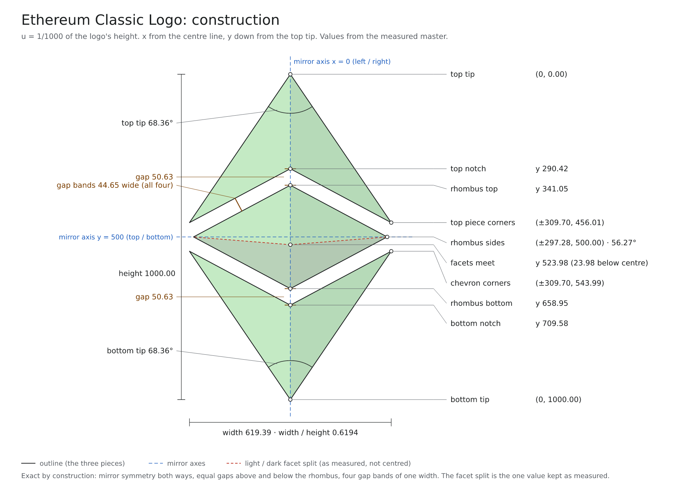
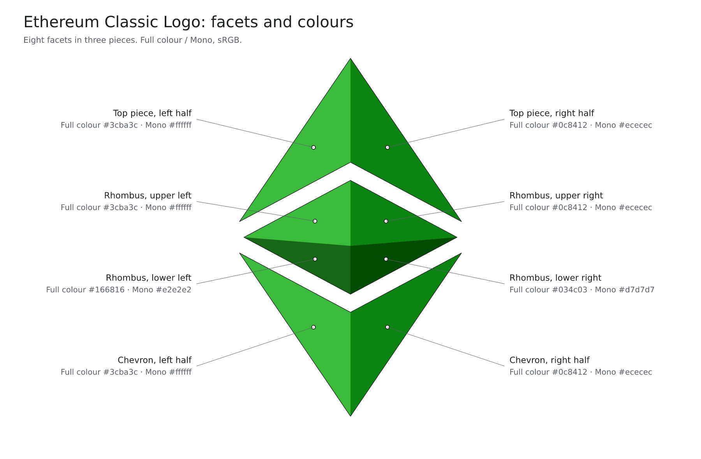

# Ethereum Classic Logo

A rebuilt vector of the Ethereum Classic logo: the 2016 faceted gem in three pieces (a notched top piece, a
rhombus and a chevron), each split into light and dark facets. Every size and angle below was measured on the
logo images Ethereum Classic publishes. This is not an official Ethereum Classic file.

## Variants

| Variant | Files | Use |
|---|---|---|
| Full colour | `svg/ethereum-classic-logo-full-colour.svg`, `svg/ethereum-classic-logo-full-colour-square.svg`, `png/transparent/ethereum-classic-logo-full-colour-*.png` | The default. Official Ethereum Classic images show it on light and on dark backgrounds. |
| Mono | `svg/ethereum-classic-logo-mono.svg`, `svg/ethereum-classic-logo-mono-square.svg`, `png/transparent/ethereum-classic-logo-mono-*.png` | White and light grey facets for dark backgrounds, as the @eth_classic profile picture shows it on black. |

## Construction

How the logo is built, in u (one thousandth of its height):

- Three pieces: a notched top piece, a rhombus and a chevron. The outline is an exact mirror image left to right
  (about the centre line x = 0) and top to bottom (about y = 500).
- Both tips are 68.36°. The top piece's outer corners are at (±309.70, 456.01),
  the chevron's at (±309.70, 543.99); the logo is 619.39 wide (width / height 0.6194).
- The rhombus's side points sit exactly half way down, at (±297.28, 500.00); its side angle is 56.27°.
- The gaps above and below the rhombus are equal, 50.63 on the centre line, and all four gaps between the
  pieces are bands of one constant width, 44.65, measured square to their edges.
- Each piece splits into a light left and a dark right facet; the rhombus also splits into upper and lower facets along two
  lines that meet the centre line at y 523.98, 23.98 below the rhombus centre. That is the one value
  kept as measured, not centred.

Vector versions: [construction drawing (SVG)](construction/ethereum-classic-logo-construction.svg),
[facets and colours (SVG)](construction/ethereum-classic-logo-facets.svg). Every value in the drawings is the one in the
specification below and in the SVG masters' coordinates.

## Specification

Units: u is one thousandth of the logo's height. x is measured from the centre line, y down from the top point.

| Measure | Value | Unit | What it means |
|---|---|---|---|
| Height | 1000.00 | u | The reference length: u is one thousandth of the logo's height. |
| Width | 619.39 | u | From the left outer corner to the right outer corner. |
| Width / height | 0.6194 |  | The width divided by the height. |
| Top tip angle | 68.36 | ° | The angle at the top point of the logo. |
| Bottom tip angle | 68.36 | ° | The angle at the bottom point. It equals the top one. |
| Top piece, outer corners (x, y) | ±309.70, 456.01 | u | The left and right corners of the top piece. x is measured from the centre line, y down from the top point. |
| Top notch (y) | 290.42 | u | Where the two lower edges of the top piece meet, on the centre line. |
| Rhombus, top point (y) | 341.05 | u | The top point of the middle diamond (the rhombus). |
| Rhombus, side points (x, y) | ±297.28, 500.00 | u | The left and right points of the rhombus. They sit exactly half way down the logo. |
| Rhombus, bottom point (y) | 658.95 | u | The bottom point of the rhombus. |
| Rhombus, side angle | 56.27 | ° | The angle at the rhombus's left and right points. |
| Chevron, outer corners (x, y) | ±309.70, 543.99 | u | The left and right corners of the bottom piece (the chevron). |
| Bottom notch (y) | 709.58 | u | Where the two upper edges of the chevron meet, on the centre line. |
| Gap above and below the rhombus | 50.63 | u | The space between the pieces, measured on the centre line. It is the same above and below. |
| Width of the gaps | 44.65 | u | The four gaps between the pieces are bands of this constant width, measured square to their edges. |
| Facet split (y) | 523.98 | u | Where the two lines that split the rhombus's colours meet the centre line: 23.98 u below the rhombus's centre. This is as measured, not centred. |
| Symmetry | exact |  | The outline is an exact mirror image left to right (about x = 0) and top to bottom (about y = 500). The facet colours are not mirrored. |
| viewBox | `-309.6964 0 619.3928 1000` | u | The SVG's coordinate frame: the top point is at (0, 0), the centre line is x = 0. |

How these were found: each value is the weighted mean of separate fits to five official images (the 2016 Media Kit PNG, the 2025 brand guide page, the 2025 guide's download, the @eth_classic profile picture and the CoinGecko icon). One pixel of those images is 2.24, 2.34, 2.50, 3.74, 2.91 u, so each value is good to about a
pixel of the finest image. The mirror symmetry, the equal gaps and the constant-width gap bands were each tested
against all five images and hold to within one pixel on every one, so they are built in exactly. The five images
are two drawings: the 2016 PNG, the profile picture and CoinGecko are one, the two 2025 images another. They
differ by about half a pixel; the report that comes with the build (REPORT.md) has the numbers.

Not specified by Ethereum Classic: clear space and minimum size.

## Colours

Per facet:

| Facet | Full colour | Mono |
|---|---|---|
| Top piece, left half | `#3cba3c` (RGB 60 186 60) | `#ffffff` (RGB 255 255 255) |
| Top piece, right half | `#0c8412` (RGB 12 132 18) | `#ececec` (RGB 236 236 236) |
| Rhombus, upper left | `#3cba3c` (RGB 60 186 60) | `#ffffff` (RGB 255 255 255) |
| Rhombus, upper right | `#0c8412` (RGB 12 132 18) | `#ececec` (RGB 236 236 236) |
| Rhombus, lower left | `#166816` (RGB 22 104 22) | `#e2e2e2` (RGB 226 226 226) |
| Rhombus, lower right | `#034c03` (RGB 3 76 3) | `#d7d7d7` (RGB 215 215 215) |
| Chevron, left half | `#3cba3c` (RGB 60 186 60) | `#ffffff` (RGB 255 255 255) |
| Chevron, right half | `#0c8412` (RGB 12 132 18) | `#ececec` (RGB 236 236 236) |

Swatches:

| Variant | Hex | RGB | Facets |
|---|---|---|---|
| Full colour | `#3cba3c` | 60 186 60 | Top piece, left half; Rhombus, upper left; Chevron, left half |
| Full colour | `#0c8412` | 12 132 18 | Top piece, right half; Rhombus, upper right; Chevron, right half |
| Full colour | `#166816` | 22 104 22 | Rhombus, lower left |
| Full colour | `#034c03` | 3 76 3 | Rhombus, lower right |
| Mono | `#ffffff` | 255 255 255 | Top piece, left half; Rhombus, upper left; Chevron, left half |
| Mono | `#ececec` | 236 236 236 | Top piece, right half; Rhombus, upper right; Chevron, right half |
| Mono | `#e2e2e2` | 226 226 226 | Rhombus, lower left |
| Mono | `#d7d7d7` | 215 215 215 | Rhombus, lower right |

Full colour is the 2016 Media Kit palette, read exactly from the lossless official images. Mono is the greys
of the @eth_classic profile picture. All colours are sRGB. The PNGs carry an sRGB chunk with the matching gAMA and
cHRM values and no ICC profile.

## Usage

| Variant | When to use it |
|---|---|
| Full colour | The default. Official Ethereum Classic images show it on light and on dark backgrounds. |
| Mono | White and light grey facets for dark backgrounds, as the @eth_classic profile picture shows it on black. |
| On-black PNGs | Extras for previews and profile-picture tests. Use the transparent files everywhere else. |

Do:

- Use the supplied files as they are: the SVG for anything that scales, the PNGs at their own size or smaller.
- Pick the variant for the background: Full colour on light or dark, Mono on dark.
- Keep enough contrast and a calm area around the logo.
- Credit the Ethereum Classic Media Kit wherever credits appear (attribution below).

Don't:

- Don't redraw, trace or regenerate the logo.
- Don't stretch, squash, skew or rotate it.
- Don't recolour it outside the two variants, and don't mix colours from both.
- Don't add effects: no glow, shadow, bevel, gradient, outline or 3D.
- Don't place it on busy backgrounds or images that hide its edges.

## Folders

| Path | What |
|---|---|
| [construction/](construction/README.md) | The construction drawings (SVG and PNG): geometry with every value, and the facets with their colours |
| [svg/](svg/README.md) | The vector masters (SVG), all transparent: Full colour and Mono, each tight and square |
| [png/transparent/](png/transparent/README.md) | Transparent PNGs, 8192, 4096, 2000, 800, 400, 150, 48 px tall |
| [png/on-black/](png/on-black/README.md) | 400 x 400 profile-picture tests on black (extras) |
| [social/](social/README.md) | Profile pictures and icons for 8 platforms |
| [LICENSE.md](LICENSE.md) | Licence and attribution |
| [MANIFEST.tsv](MANIFEST.tsv) | Every file with size, dimensions and SHA-256 |
| [SHA256SUMS.txt](SHA256SUMS.txt) | Checksums (`sha256sum -c SHA256SUMS.txt`) |

The SVG masters are one complete, editable logo each, all transparent: three groups, one per piece, each holding a
base shape (the piece outline) and on top the 8 facets as individual named shapes, for design tools and production.
Two framings: tight (the viewBox is exactly the logo) and square (the logo 67 % of the
height and centred, as on the profile pictures). The bases stop the background showing through where two facets
meet; delete the bases only for cutting or embroidery. For screens the PNGs are still the best files. Details in
[svg/README.md](svg/README.md).

Changes against the zips of 2026-10-15 (same zip names): the on-black PNGs are now the two 400 x 400
profile-picture tests (`png/on-black/*-on-black-400x400.png`) instead of the 800 px files. No on-black SVG is made
any more (decision 10, 2026-10-20): the SVGs are the four transparent files, tight and square. Links to the removed
members need updating.

## Attribution and licence

Vector rebuilt from the Ethereum Classic logo (Ethereum Classic Media Kit, https://github.com/ethereumclassic/Media_Kit, CC BY 4.0); modified and rebuilt by lal's studio team (brolal). Not an official ETC file. The licence covers copyright only: no trademark rights and no endorsement implied.

Licence: [CC BY 4.0](https://creativecommons.org/licenses/by/4.0/). Source: [Ethereum Classic Media Kit](https://github.com/ethereumclassic/Media_Kit). Details in [LICENSE.md](LICENSE.md).

Released 2026-10-19.
